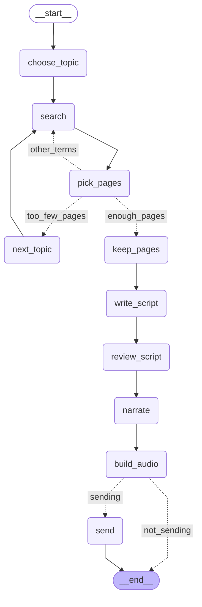

# news_podcast · Resumo das 7

Every day a voice message reaches Telegram with two hosts (Bia and Léo) telling what
happened in the previous 24 hours, from the feeds registered in the admin. It arrives
around 7:00 and, by default, lasts 12 to 18 minutes (8 to 12 at 1.5x). Feeds, length,
speed, models, prices and prompts change in the Django admin (see *Settings*). The
episode is only that voice message: each run's cost and result stay in the admin's
history, and the sources it used, in the run's log on Railway. The `lesson` action
makes a lesson of under 10 minutes on one topic of the course in the admin, from
pages of trusted sites (see *Lesson graph*).

The app has its own database, `news_podcast_db` (`NEWS_PODCAST_DATABASE_URL`), with the
settings, the feeds, the lesson catalog and the history. The rest is a management
command.

## How it works

| Step | File | What happens |
|---|---|---|
| Feeds | `api/episode/feeds.py` | Downloads the admin's active feeds in parallel and keeps only what came out between 6:00 yesterday and 6:00 today. |
| Selection | `api/episode/selection.py` + selection prompt | The text model, through `TextModels` (`api/core/llm.py`, with LangChain), gets every headline, groups the ones about the same fact, applies the editorial rules and, weighing how many different outlets reported each fact (each outlet counts once), picks one story for every minute and a half of episode (8 to 12 by default), with each one's length. |
| Reading | `api/episode/articles.py` | For each story, reads the full text from up to 3 outlets (ICL first). The other outlets that ran the story come in as headlines. Video pages, which have no text, are not read, and another outlet takes their slot. Every feed is from a site without a paywall. |
| Script | `api/episode/script.py` + script prompt | The text model, also through `TextModels`, writes the dialogue at 170 words per minute of episode, times the speed (2,040 to 3,060 words by default), opening with 3 to 5 short headlines, as TV news shows do. If it comes out too short, it asks once for a longer version. |
| Voice | `api/core/voice/` | The voice model reads the dialogue with the two hosts' voices, in chunks of about 650 words, through its provider's implementation (`GeminiVoice`, the only one for now). If Gemini is down, the code waits and tries again (see *Good to know*). |
| Audio | `api/core/audio.py` | ffmpeg joins the chunks, normalizes the volume and makes a 32 kbps OGG/Opus file (about 4 MB for 15 minutes), the format of Telegram voice messages. |
| Sending | `api/core/telegram.py` | `sendVoice` with the title and the date in the caption (as a voice message, Telegram shows the 1x, 1.5x, 2x speed button). It goes out as soon as it is ready, without waiting for the full hour. If something fails, a message says in which step. |

The daily episode runs on a Railway Cron service (see *Scheduling*).

## Setup (once)

- **Telegram bot:** create it with `@BotFather` (`/newbot`), keep the token and send
  `/start` to the bot.
- **Gemini key:** at [aistudio.google.com](https://aistudio.google.com), *Get API key*.
  The free plan asks for no card.
- **Database:** `news_podcast_db` on Railway's Postgres, with
  `NEWS_PODCAST_DATABASE_URL` also on the backend service (the admin uses the database),
  and the migrations applied (`make migrate-prod`, which reads `.env.production`).
- **Starting data:** `make seed` fills a local database from `news_podcast/seed/`:
  the settings rows from `settings.json` and `lesson_settings.json` when they are
  missing, the feeds from
  `feeds.json` when the list is empty, and the lesson catalog from `catalog.json`
  when it has no area. So a value changed or a feed added in `seed/`
  after a database was seeded reaches it only through the admin. `make seed-prod`
  runs only when `PLAN.md` says so, for a release that brings starting data for a
  new table, such as the lesson catalog, and it shows the database's address and
  asks for `yes`.
- **Your chat:** with `TELEGRAM_BOT_TOKEN` in `.env`, run
  `uv run python manage.py news_podcast chat-id` from the `backend/` folder. The bot sends
  you the conversation's number, which goes in the service's `TELEGRAM_CHAT_ID` (see
  *Scheduling*). For a group, see *Sending to a group*.

## Scheduling (Railway)

A Cron service in the Railway project, from the same repository:

1. *New → GitHub Repo* with this repository. In *Settings*: Root Directory `/backend`,
   branch `main`, Custom Start Command `python manage.py news_podcast episode
   --scheduled` and Cron Schedule `40 9 * * *` (6:40 in Brasília; Railway uses UTC).
2. In *Variables*: `RAILPACK_DEPLOY_APT_PACKAGES=ffmpeg` (installs ffmpeg on this
   service only), `GEMINI_API_KEY`, `OPENAI_API_KEY` (only if a text model is OpenAI's),
   `TELEGRAM_BOT_TOKEN`, `TELEGRAM_CHAT_ID`, `TELEGRAM_ADMIN_CHAT_ID` and
   `NEWS_PODCAST_DATABASE_URL`. To start, Django also needs `SECRET_KEY`,
   `API_TOKEN_SECRET` (32 characters or more), `OPEN_WEATHER_API_KEY`, `SERVER_URL`,
   `NGROK_URL`, `FRONT_END_URL`, `ENVIRONMENT=development` (so it doesn't ask for
   `REDIS_URL`) and the other four `*_DATABASE_URL`. Dummy values work for those (the
   database URLs can be `sqlite:///dummy.db`), since the podcast only uses its own
   database.

The episode goes out as soon as it is ready. Its name ("Resumo das 7") and the greeting
follow the next full hour after the run starts, and the news goes up to the full hour
before: with the cron at 6:40, it reads what came out until 6:00 and arrives around 7:00.
To change the time or the frequency, change only the Cron Schedule, in UTC and about 20
minutes before the episode's hour (`40 21 * * *` sends around 19:00 in Brasília). Avoid
the midnight episode (cron between 23:00 and 0:00 in Brasília): it would arrive before
midnight, already dated the next day. A run only starts if the previous one has ended.

A backend deploy also redeploys this service and kills a running execution, with no
grace period. So releases to `main` stay out of the episode's time, from 6:40 until it
arrives.

To run it by hand, use the service's *Run now* or `railway cron run`. Since it is the
cron's command, it respects the pause and reads the news up to the full hour it started
in. Run locally without `--scheduled`, it reads the news up to the moment it starts.

## Sending to a group

The bot only sends to the `TELEGRAM_CHAT_ID` conversation. Someone who just opens the bot
and sends `/start` gets nothing. For more people to listen, use a group:

1. In Telegram, create a group with the people and add the bot (search for its @). If
   only admins can post in the group, make the bot an admin; otherwise Telegram refuses
   the send.
2. Run `chat-id` (see *Setup*). With `TELEGRAM_CHAT_ID` or `TELEGRAM_ADMIN_CHAT_ID` in
   `.env`, the bot sends only to that conversation the list of the conversations it saw
   in the last 24 hours, with each one's number. The group shows with 👥 and a negative
   number.
3. Replace `TELEGRAM_CHAT_ID` with the group's number on the Railway service. From then
   on the episode goes to the group. Error notices, including one about a send the group
   refused, go to `TELEGRAM_ADMIN_CHAT_ID` (the number of your conversation with the
   bot), so they don't show up in the group; without it, they go to the group too.

If the group isn't in the list (Telegram only keeps the last 24 hours for the bot), send
`/start@bot_name` in the group and run it again. If Telegram turns the group into a
supergroup, which happens when some of its settings change, the number changes: repeat
steps 2 and 3.

## Settings

They live in the Django admin, under *News podcast → Settings*. It is a single row,
created only by the seed (`make seed`, see *Setup*), and after that it changes only in
the admin. Without it, a run fails at "configurações" and the Settings page says to
run the seed. Each change applies from the next run on, and an invalid value doesn't
save: the admin shows the error on the field.

- **Paused:** Railway's runs (the cron and *Run now*) end with no episode.
- **Length and speed:** the length is the file's, already at the chosen speed. With
  `1.25`, the script is 25% longer to fit the same time, and the voice costs 25% more.
  The number of stories follows the length (one every minute and a half).
- **Limit:** the maximum length times the speed can reach 30 minutes of speech
  (`MAX_SPEECH_MINUTES` in `api/core/config.py`). Each voice request makes about 4
  minutes and the free plan allows 10 requests a day, so 30 minutes take about 8
  requests. On the paid plan, this limit can go up.
- **Models and prices:** the text model, the fallback (optional) and the voice model,
  each with its price in US$ per million input and output tokens, from the provider's
  price list. The history's cost uses these prices, so a new model needs its price. Text
  models are written `provider:model`, with `google_genai` or `openai`
  (`google_genai:gemini-3.8-flash`, `openai:gpt-4.1-mini`); a bare name that starts with
  `gemini` is Google's, and the admin refuses any other provider. To use an OpenAI model,
  first put `OPENAI_API_KEY` on the cron service, and the prices from OpenAI's price
  list. The voice model is written the same way, and `google_genai` is the only voice
  provider for now (`google_genai:gemini-3.8-flash-lite-tts` or the bare
  `gemini-3.8-flash-lite-tts`); *Adjustments* says how to add another.
- **Prompts and voice styles:** the selection prompt, the script prompt and the
  lengthening prompt (asked once, when the script comes out short), and the styles of the
  conversation and of the opening headlines. Each prompt accepts only the `{fields}`
  listed under it, with no format (`{today}` works, `{today:%d}` doesn't); a literal
  brace is written `{{` or `}}`. If you change the style or the voice, adjust
  `NATURAL_WORDS_PER_MINUTE` (the voice's words per minute before ffmpeg); otherwise the
  episode comes out shorter or longer than planned.

**Lesson settings** (*News podcast → Lesson settings*) are a second single row, also
created only by the seed and shown the same way when it is missing. They hold the
lesson's minimum and maximum minutes (at least 1, and under 10: `LESSON_MINUTES_LIMIT`
in `api/lesson/config.py`), its own voice model with its two prices, the choice, pick,
script and review prompts, and the lesson voice style. The text models, their prices
and the speech speed come from *Settings*.

## Feeds

They live in the admin, under *News podcast → Feeds*: outlet, section, URL and whether
it is active (a feed turned off stays out without being deleted). The list comes from
the seed and, after that, changes only in the admin; with every feed deleted, a run
fails at "leitura dos feeds".

- **Which sites:** only sites without a paywall. To read the full article, the domain
  must be in `FULL_TEXT_DOMAINS` (`api/episode/config.py`); outside that list, the
  article comes in only with the RSS title and summary.
- **Outlet:** an outlet's feeds share the same name, because each story reads one source
  per outlet and a headline repeated in two of its feeds counts once.
- **Google News:** sites without RSS come in through a search, such as
  `https://news.google.com/rss/search?q=site:site.com.br+when:1d&hl=pt-BR&gl=BR&ceid=BR:pt-419`.
  A search brings at most 100 items, so big sites, such as CNN Brasil and Poder360, come
  in by section, and SBT's leaves its videos out (`-site:sbtnews.sbt.com.br/videos`).

## Lesson catalog

The lessons' topics, in 7 areas, live in the admin under *News podcast → Areas* and
*Topics*. The seed fills an empty catalog once; after that it changes only in the
admin.

- **Order:** each area's topics are taught by position, from the lowest; areas too.
  Positions can be edited right in the lists.
- **Active:** an unticked topic leaves the course without being deleted.
- **Taught on:** the São Paulo date of the latest lesson that was sent with the topic.
  Failed and not-sent lessons don't count, and deleting a lesson's row in the history
  makes its topic available again.
- **Deleting:** a topic with lessons in the history can't be deleted, nor can its
  area; untick it instead.
- **Picking:** each area offers its next topic. A topic tied to one of the day's
  stories goes first, with the story as the opening; otherwise the area taught
  least recently goes, and an area never taught goes before any other.

## Lesson sources

Each lesson searches for its pages with Tavily when it is made (`api/lesson/sources.py`),
only on the trusted sites of `LESSON_SOURCE_DOMAINS` (`api/lesson/config.py`), each
with its subdomains:

- `leg.br`: the Câmara, the Senado and the Congresso, and the state and city
  legislatures too;
- `jus.br`: the courts, the TSE included;
- `gov.br`: the federal government, with the Banco Central, the IBGE and the Tesouro,
  and the state and city governments too;
- Politize! and Agência Brasil.

The pick leaves out pages about something else. Wikipedia isn't on the list, by the
owner's choice. Neither is ICL Notícias: a search covers its whole site, opinion
pieces included. The code checks each result's host again and keeps only pages with
text. Nothing is downloaded, since the text comes from Tavily.

- **The pick:** a text model picks up to 3 pages, best first, and may ask for one more
  search with other words.
- **At least 2 pages:** with fewer, the next topic is tried, with a warning to the
  admin chat naming the skipped one. A lesson searches at most 2 topics, twice each, so
  it spends 8 Tavily credits at most; the history doesn't count them.
- **Key:** the search needs `TAVILY_API_KEY`. Without it, or when Tavily fails, the
  lesson fails at "busca das fontes".

## Lesson script

One text request writes the lesson as a dialogue from its pages only: Bia explains
and Léo asks, it opens from the motivating story when there is one, cites its sources
by name, builds on the area's earlier lessons and closes with a short recap
(`api/lesson/script.py`).

- **Length:** the lesson's minimum and maximum minutes (6 to 9 in the seed) at 150
  words a minute (`LESSON_WORDS_PER_MINUTE`), times the speech speed. A script more
  than 1.1 times the maximum is asked again, so a lesson stays under 10 minutes; a
  short one is fine, and there is no request to lengthen it.
- **Review:** a second request checks the script against its pages. It removes or
  corrects what they don't support and any changing figure without a date. It may cut
  and correct, but adds no turn: a reviewed script with more turns, more than 5%
  longer, or over the lesson's ceiling is asked again. Each change goes to the log. When no model gives a valid review, there is no lesson that day.

## Lesson graph

The lesson runs as a LangGraph graph (`api/lesson/graph.py`, the only module that
imports langgraph). Each node is an async function of the lesson's state and the
run's context, and a failure keeps the step it happened at and the cost paid so far.



The last nodes voice the lesson, build its file and send it (`api/lesson/delivery.py`):

- **Voice:** the lesson's own voice model, from *Lesson settings*, so it has its own
  free daily quota, read in the lesson voice style. Like the daily's, it has no
  fallback: an unavailable voice gets the waits of `VOICE_RETRY_MINUTES` (10 and 20
  minutes), and a used-up quota or a refused request fails the lesson at once.
- **Audio:** `news_podcast_output/aula-YYYY-MM-DD.ogg`, at the speech speed of
  *Settings*. A lesson over 10 minutes still goes out, with a warning to lower the
  maximum minutes or recalibrate `LESSON_WORDS_PER_MINUTE`.
- **Sending:** one voice message to `TELEGRAM_CHAT_ID`. The caption has the topic, its
  area and a link to each page under its title, cut so the caption fits Telegram's
  1,024 characters.
- **Failures:** the admin chat gets "Não consegui gerar a aula de hoje" with the step
  and the error; with `--no-send`, only the log does. A lesson stops after 90 minutes
  (`MAX_LESSON_MINUTES`).

## History

Under *News podcast → Episodes*, one row per run: start time (Brasília), kind (news or
lesson), status (sent, failed or, with `--no-send`, not sent), length, words per
minute, cost on the paid plan in reais and, if it failed, the step and the error. Each
run's page shows the script's words and the tokens of each model answer. At 1x speed,
the words per minute are the voice's pace: if they are far from 170,
`NATURAL_WORDS_PER_MINUTE` in `api/core/config.py` needs adjusting, or the episode
comes out shorter or longer than asked (for a lesson, 150 and
`LESSON_WORDS_PER_MINUTE` in `api/lesson/config.py`). The audio is not kept. The top of
the list shows the total cost of what is filtered (by month, kind or status). A paused
run doesn't show up, and one that fails midway records the cost of what already ran.

A lesson's page also shows its topic, the news story that opened it and the pages it
came from, which a failed lesson keeps once its pages were found. Its cost counts the
text at the prices in *Settings* and the voice at those in *Lesson settings*, plus
the day's selection when the `lesson` action made it. If its topic is deleted in the
admin while it runs, the row is saved without it, with the topic's title in the
error, and the admin chat is told.

## Adjustments

- **The hosts and their voices:** `HOSTS` in `api/core/config.py`, with each host's
  voice for each voice provider (on Gemini, Bia is Kore and Léo is Charon).
- **Another voice provider:** write its implementation in `api/core/voice/`, a class
  with `synthesize`, like `GeminiVoice` in `gemini.py`; add it to `VOICE_PROVIDERS` in
  `api/core/voice/providers.py`, which builds the voice and which the admin checks the
  voice model against; give each host in `HOSTS` its voice for that provider; then
  write `provider:model` and its prices in the admin.
- **The dollar rate used to show costs in reais:** `BRL_PER_USD` (fixed) in
  `api/core/config.py`.

To run it locally without sending, from the `backend/` folder, with ffmpeg installed,
the keys and `NEWS_PODCAST_DATABASE_URL` in `.env`, the migrations applied and
`make seed` run:

```
uv run python manage.py news_podcast episode --no-send
uv run python manage.py news_podcast lesson --no-send
```

The audio and the episode's selection and script JSON go to
`backend/news_podcast_output/`, which is in `.gitignore`. The `lesson` action, which
also needs `TAVILY_API_KEY`, reads the feeds and makes the day's selection, as the
episode does, then makes a lesson with no episode, so the lesson never says the news
went out. Without `--no-send` it goes to `TELEGRAM_CHAT_ID` and counts as taught. A
*Lesson settings* row seeded before the lesson's prompts were final keeps the old
ones: paste the prompts from `seed/lesson_settings.json` in the admin, or delete the
row and run `make seed` again.

## Good to know

- The history's cost is the paid plan's; on the free plan, a run costs nothing. The
  starting prices are promotional until 2026-12-31 and double on 2027-01-01 (text 1.50
  and 7.50; voice 1.00 and 12.00 per million tokens): update them in the admin that day.
- The speed speeds up the file itself with ffmpeg's `atempo` filter. The speed button of
  Telegram's player (1x, 1.5x, 2x) still works, and the two speeds multiply.
- If the text model is overloaded, the text is made with the fallback, and the next
  steps go straight to it. If neither gives a good answer while one of them is down, the
  code waits 10 minutes, then 20, and asks both again, and the episode arrives that much
  later.
- Each model gets two answers before the next one. A request that fails because of an
  overload, a per-minute limit or the connection is sent again up to 3 times, waiting as
  long as the provider asks. A model out of the day's quota, without its key, with an
  unknown provider or that refuses the request is left out until the end of the run,
  with the reason in the log and in the error.
- After changing the text model, listen to the first episodes: the prompts were tuned
  for Gemini.
- The voice has no fallback: if Gemini is down, the code waits 10 minutes, then 20, and
  tries again, and the episode arrives that much later. If it still fails, or if the
  day's quota runs out, the day's episode doesn't go out and an error message arrives on
  Telegram.
- A run that goes past 2 hours stops and sends an error message: Railway doesn't start
  the scheduled run while the previous one is running, and a stuck run would block the
  next days.
